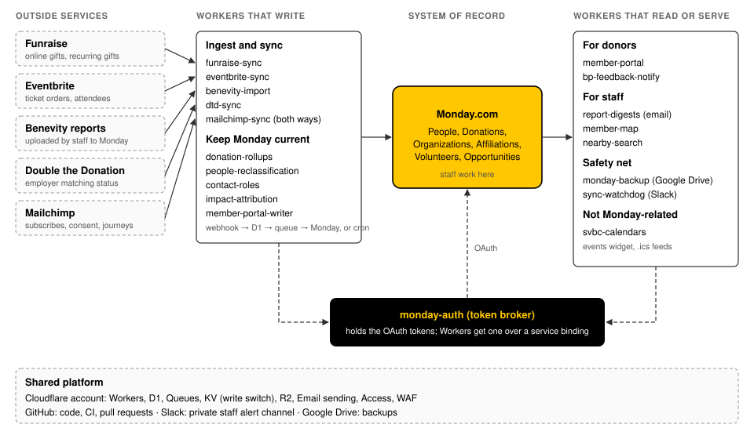

# System overview

## The shape of the system

**Monday.com is SVBC's system of record** for people, gifts, organizations, affiliations,
volunteers and fundraising opportunities. Staff work in Monday's web interface. Monday has no
built-in connection to most of the services SVBC uses, and some of what SVBC needs isn't
available on its Pro plan: scheduled digests, recalculated donor rollups, a donor-facing portal.
Small Cloudflare Workers fill those gaps. Each Worker does one job and has its own directory, tests,
configuration, database and deploy.

The Workers fall into four groups:

1. **Ingest and sync.** These bring events from outside services into Monday: online gifts,
   ticket orders, workplace-giving reports, matching-gift status and email consent.
2. **Keep Monday current.** These recompute values Monday can't calculate itself (lifetime giving,
   membership, acknowledgment tier), move inactive people to a historical board, maintain
   contact roles and propose employer affiliations.
3. **Read and serve.** These read Monday to serve donors (the member portal), staff (email
   digests and maps) and outside services.
4. **Safety net.** These are nightly backups and the watchdog that tells staff when a sync goes
   quiet.

`svbc-calendars` predates the rest. It serves the public website's events widget and calendar
feeds from Eventbrite and doesn't touch Monday.

All of the Workers reach Monday through one broker, `monday-auth`, which holds the OAuth tokens
of a dedicated integration user. No Worker holds a Monday token of its own.
[Chapter 2](02-architecture.md#monday-access-the-token-broker) explains why.

## The Workers at a glance

| Worker | Group | Trigger | What it does |
|---|---|---|---|
| [`funraise-sync`](workers/funraise-sync.md) | Ingest | Webhook, hourly cron | Funraise donations become Donations items; recurring gifts are mirrored hourly |
| [`eventbrite-sync`](workers/eventbrite-sync.md) | Ingest | Webhooks, hourly cron | Paid Eventbrite orders become Donations items; attendee feeds for classes |
| [`benevity-import`](workers/benevity-import.md) | Ingest | Monday webhook, daily cron | A Benevity report staff upload to Monday becomes Donations items |
| [`dtd-sync`](workers/dtd-sync.md) | Ingest | Hourly cron | Double the Donation matching-gift status in both directions |
| [`zoom-phone-sync`](workers/zoom-phone-sync.md) | Ingest | Webhooks | Zoom Phone calls and texts become People timeline entries. **Ingest only, not deployed** |
| [`mailchimp-sync`](workers/mailchimp-sync.md) | Ingest / serve | Webhooks, crons | Keeps Mailchimp's audience and Monday's People and consent columns in step |
| [`donation-rollups`](workers/donation-rollups.md) | Keep current | Monday webhooks, crons | Lifetime and yearly giving, membership, tier and last gift on People and Organizations |
| [`people-reclassification`](workers/people-reclassification.md) | Keep current | Daily cron, webhook | Moves people inactive for 7 years to People (Historical), and back |
| [`contact-roles`](workers/contact-roles.md) | Keep current | 10-minute cron | Fills the read-only Contacts column on opportunity boards from affiliations |
| [`impact-attribution`](workers/impact-attribution.md) | Keep current | Nightly cron | Proposes draft employer affiliations from matching gifts and email domains |
| [`member-portal`](workers/member-portal.md) | Serve | HTTP (donors), daily cron | Donors sign in by email link, see their giving and membership, request changes |
| [`bp-feedback-notify`](workers/bp-feedback-notify.md) | Serve | Monday webhook | Emails an event organizer a feedback request after a bike-parking event |
| [`report-digests`](workers/report-digests.md) | Serve | Hourly cron | Scheduled email digests of Monday board views for staff |
| [`member-map`](workers/member-map.md) | Serve | HTTP (staff), weekly cron | Staff-only map of members and membership gaps |
| [`nearby-search`](workers/nearby-search.md) | Serve | HTTP (staff), hourly cron | Staff-only search for contacts near an address or road |
| [`monday-backup`](workers/monday-backup.md) | Safety net | Daily cron, Workflow | Encrypted snapshot of every Monday board and doc to Google Drive |
| [`sync-watchdog`](workers/sync-watchdog.md) | Safety net | Hourly cron | Slack alert when a cron stops, a write switch is wrong or a queue backs up |
| [`status-page`](workers/status-page.md) | Serve | HTTP (staff) | Staff status page: SVBC syncs, Cloudflare and SaaS vendor status |
| [`monday-auth`](workers/monday-auth.md) | Platform | Service binding, cron | Monday OAuth token broker for every other Worker |
| [`svbc-calendars`](workers/svbc-calendars.md) | Website | HTTP (public), cron | Events widget and committee and event `.ics` calendar feeds |
| [`svbc-bike-lanes`](workers/svbc-bike-lanes.md) | Serve | HTTP (staff), weekly build | Staff-only tracker of bike lane miles by county, city and class |
| [`quickbooks-sync`](workers/quickbooks-sync.md) | Ingest | Webhooks | QuickBooks invoices and customers. **Postponed indefinitely**, so its writes stay off. |
| [`salesforce-import`](workers/salesforce-import.md) | One-time | Local CLI | The Salesforce → Monday migration pipeline, kept for reference and re-runs |
| [`geo-filter`](workers/geo-filter.md) | Tool | Local CLI | Lists contacts near a point, zip code or corridor, on request |

Two more items in the repository aren't on that list:

- **`sponsor-outreach/`** holds requirements and a board-setup script
  ([`scripts/sponsor-outreach-setup.mjs`](../../scripts/sponsor-outreach-setup.mjs), runbook
  [`docs/runbooks/sponsor-outreach-setup.md`](../runbooks/sponsor-outreach-setup.md)) for the
  yearly corporate-sponsor email. No Worker exists for it yet. If one is built, it gets a chapter
  here.
- **[`scripts/`](../../scripts/)** at the repository root holds CI checks and operator tools that
  span Workers ([chapter 7](07-operations.md#operator-scripts-at-the-repo-root)).

## Outside services

| Service | Used for | Direction |
|---|---|---|
| Monday.com (Pro plan, CRM and Work Management seats) | System of record | Read and write |
| Cloudflare (Workers Paid; the zone's Business plan through Project Galileo) | Runs every Worker, plus D1, Queues, KV, R2, Email sending, Access and WAF on `bikesiliconvalley.org` | Platform |
| GitHub | Source code, pull requests, CI (GitHub Actions) | Platform |
| Funraise | Online donation forms | Inbound webhook and API |
| Eventbrite | Event tickets and registrations | Inbound webhook and API |
| Mailchimp | Newsletter audience, membership journeys | Both ways |
| Double the Donation | Employer matching-gift lookups | Both ways (API) |
| Benevity | Workplace-giving disbursement reports | Staff upload a file to Monday |
| Google Workspace (Shared Drive) | Backup destination | Outbound |
| Slack | Private staff alert channel | Outbound |
| Census Geocoder, OpenStreetMap | Geocoding and map tiles for the staff maps | Outbound, no account |
| Intuit QuickBooks Online | Accounting sync (postponed) | Not in use |
| Box | Where this manual's PDF is published | Not used by code |

[Chapter 3](03-accounts-and-access.md) covers each account: who administers it (by role), what
the Workers use it for, and where its credentials go.

## Where things run

- **Everything that runs continuously runs on Cloudflare's network**, in SVBC's Cloudflare
  account. No servers, containers or virtual machines need patching.
- **Custom hostnames** are on the `bikesiliconvalley.org` zone, which the same Cloudflare account
  manages. Examples: `member.bikesiliconvalley.org` for the portal,
  `events.bikesiliconvalley.org` and `committees.bikesiliconvalley.org` for calendars, and
  `map.bikesiliconvalley.org`. Most webhook receivers use their `*.workers.dev` address instead.
  Appendix A lists every route.
- **The two command-line tools** (`salesforce-import`, `geo-filter`) and the operator scripts run
  on an operator's laptop with Node.js.
- **The sandbox** is a second, isolated copy of most Workers. It points at a sandbox Monday
  workspace and sandbox vendor accounts ([chapter 4](04-environments.md)).
